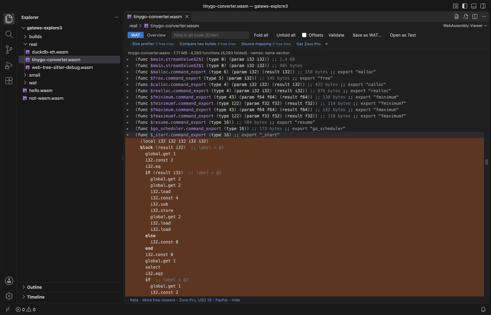

# WebAssembly Viewer (WASM, WAT)

WebAssembly viewer by Zovo for VS Code: click a `.wasm` file and read it as WAT text, with one fold per function, instead of binary noise. The Overview tab shows what is inside the module: sections with their sizes, imports, exports, memories, tables, globals, custom sections and the name section. WAT to WASM and WASM to WAT work in the editor, with errors and their line numbers. No toolchain to install, no account, no network.

## Free

- Open `.wasm` files as WAT text in the wasm2wat layout: types, imports, functions, tables, memories, globals, exports, elements and data. Names from the name section (`$main`, `$memcpy`) when the module has them.
- Fold and unfold each function. Large modules open folded and print a function only when you open it, so a 35 MB module opens in about a second.
- Click a `call`, `ref.func` or an export to go to its function. Find in all code searches every function, folded or not.
- Overview: file and code size, every section with its offset, size and share, imports with their types, exports (click one to go to its function), memories in pages and bytes, tables, globals with their values, custom sections, the name section, producers and target features.
- Validate checks the whole module with wabt (types, stack, indices) and lists each problem with its byte offset.
- Save as WAT writes the text to a `.wat` file; Open as WAT Text shows it in a read-only text editor.
- `.wat` and `.wast` files get syntax colors, an outline, folding and errors with line and column while you type. Compile WAT to WASM writes the `.wasm` next to the file and opens it in the viewer.
- Reads modern modules: SIMD and relaxed SIMD, threads and atomics, exception handling (old and new), GC and reference types, tail calls, multi-memory, memory64 and multi-value.
- Byte offsets next to each instruction (the Offsets box), for crash reports and hex dumps.
- No network requests, no telemetry, nothing shows when VS Code starts.

## Zovo Pro

Zovo Pro: USD 19 once. One payment unlocks the Pro tools in every Zovo extension. Each Pro tool has 3 free tries:

- Size profiler: what makes the `.wasm` big. The biggest functions and data segments, size by section, by import module and by crate, namespace or Go package, the bytes each function keeps alive, functions nothing calls, and for any function the call chain that keeps it in the build. Copy or save the report as Markdown.
- Compare two builds: this build against another `.wasm` or the git HEAD version. Total and section sizes, functions added, removed, grown and shrunk (matched by name, hash suffixes ignored), imports and exports, and a Markdown size table to paste into a pull request.
- Source mapping: reads DWARF line tables (`.debug_line`, also from a separate debug file) or a source map next to the module. Shows the source file and line of each function, the code size per source file, and the source line next to each instruction in the WAT view. Click a file to open it.

The Pro tools are in the viewer toolbar, the Command Palette (they end in "(Pro)") and the Explorer right-click menu on `.wasm` files ("Zovo Pro: ..."). A try counts only when the tool showed its result. `wasmViewer.showProTools: false` hides all of it.

Run Zovo Pro: Get Zovo Pro to pay by card, with GitHub Sponsors or PayPal (team of 5: USD 59), or to enter a key.

## How to use it

Click a `.wasm` file in the Explorer: it opens in the viewer. The toolbar switches between WAT and Overview, folds or opens all functions, finds text in all code (Enter starts the search, Ctrl+F or Cmd+F jumps to the box), shows byte offsets, validates the module and saves or opens the text.

For a `.wat` file, the Compile WAT to WASM button in the editor title bar (or a right-click on the file) writes `name.wasm` next to it. Errors show in the Problems view with their line and column, and the cursor jumps to the first one.

## Settings

- `wasmViewer.useNames`: use names from the name section in the text (default on).
- `wasmViewer.openFunctionsBelowKB`: modules up to this size open unfolded (default 1536).
- `wasmViewer.showOffsets`: byte offsets left of the text (default off).
- `wasmViewer.checkWat`: errors while you type in `.wat` files (default on).
- `wasmViewer.openAfterCompile`, `wasmViewer.openAsTextMaxMB`, `wasmViewer.maxFileSizeMB`.
- `wasmViewer.showProTools`, `wasmViewer.askForRating`, `wasmViewer.showSupportLinks`.

## Privacy

No network requests and no telemetry. Files are read from your disk only; the viewer never writes to a `.wasm` file. WAT to WASM and Validate use wabt (Apache 2.0), bundled as WebAssembly inside the extension. Compare with git HEAD runs your local `git show`, only in a trusted folder. A source map on the web is never downloaded.

## Known limits

- WebAssembly components (the component model) are not read yet; core modules are.
- Folded s-expression output (the `(i32.add (local.get 0) ...)` style) is not offered; the text is flat, like wasm2wat's default.
- Source mapping reads line tables only: no variables, types or inlined call stacks. DWARF 2 to 5 and v3 source maps are read; split DWARF (`.dwo` files) is not.
- Open as WAT Text asks first for modules over 16 MB, because the text of a large module can be hundreds of MB. Save as WAT works for any size.

## Support Zovo

Zovo Pro: USD 19 once, every Zovo viewer. [Get Zovo Pro on GitHub Sponsors](https://github.com/sponsors/theluckystrike/sponsorships?tier_id=679878) to turn on the Pro tools in this extension and in the other Zovo extensions you use. The free features stay free.

Zovo extensions have no ads and no tracking. They are made by [theluckystrike](https://github.com/theluckystrike) on GitHub. You can also support the work with no Pro:

- [Sponsor on GitHub](https://github.com/sponsors/theluckystrike)
- [PayPal](https://www.paypal.com/paypalme/najzzz)
- [Follow theluckystrike on GitHub](https://github.com/theluckystrike)

### Need your format supported?

Open a [format request](https://github.com/theluckystrike/wasm-viewer-vscode/issues/new?template=format-request.yml) with a sample file, and I reply there whether it can be done. For USD 299 once, through [this GitHub Sponsors tier](https://github.com/sponsors/theluckystrike/sponsorships?tier_id=679995), I add your file format or a missing feature to this extension, with tests, within 7 days.

## More tools by Zovo

- [Linker Map Viewer & Map File Analyzer (GNU ld, Memory Usage)](https://marketplace.visualstudio.com/items?itemName=zovo.zovo-linker-map-viewer) shows FLASH and RAM use from GNU ld, lld, IAR and Keil map files.
- [VCD Viewer & Waveform Viewer (Verilog, No Signal Limit)](https://marketplace.visualstudio.com/items?itemName=zovo.zovo-vcd-waveform-viewer) opens Verilog, SystemVerilog and VHDL VCD waveforms with no signal limit.
- [PCAP Viewer & PCAPNG Viewer (Packet Capture Analyzer)](https://marketplace.visualstudio.com/items?itemName=zovo.zovo-pcap-viewer) opens PCAP and PCAPNG captures with a packet list, filters and a hex pane.
- [Hex Viewer & Binary Viewer, Hex Editor (Large Files)](https://marketplace.visualstudio.com/items?itemName=zovo.zovo-hex-viewer) opens binary files of any size, with find, a data inspector and byte editing.
- [Run C++ and C Code: One-Click Compile with GCC, G++, Clang (CPP Runner, Input Panel)](https://marketplace.visualstudio.com/items?itemName=zovo.zovo-run-cpp) compiles and runs the current C or C++ file with gcc or clang.

See [all Zovo extensions on the Marketplace](https://marketplace.visualstudio.com/publishers/zovo).
